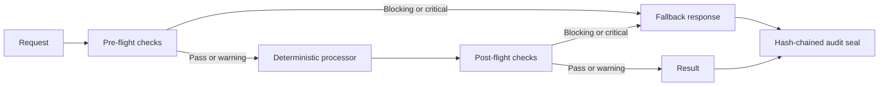

# GuardrailAI: Deterministic Workflow Layer

> **Deterministic pre/post execution guardrails, circuit-breaker routing, and tamper-evident SHA-256 audit trails for agentic workflows.**

[](pyproject.toml)
[](tests/)
[](guardrailai/server.py)

GuardrailAI makes policy decisions inspectable: typed requests pass through explicit input checks, deterministic processing, output checks, and a hash-chained audit ledger. A bilingual English/Arabic Studio exposes the same FastAPI execution and verification endpoints.

## Engineering highlights

- **Explicit control flow:** `ComplianceAgent`, `ProcessAgent`, and `AuditAgent` have separate responsibilities. Both `BLOCKING` and `CRITICAL` violations route to fallback; warnings remain visible in the response.
- **Reproducible processing:** financial references use a canonical payload digest; escalation references use a workflow ID digest. Regression tests compare separate Python processes with different hash seeds and reordered payload keys.
- **Field-complete audit hashing:** every stored block field except its own digest participates in SHA-256, including genesis contents, timestamps and metadata. Verification also checks workflow identity, sequence and previous links; caller-owned metadata is deep-copied on append.
- **Executable failure paths:** tests cover field mutation, an empty ledger, pre-flight blocking, injected post-flight blocking, fallback responses and API access.

## Workflow



The processor contains local domain demonstrations. The orchestration boundary is the extension point for an application-owned processor. No model API key is needed to run the current pipeline.

## Implemented policy examples

| Domain | Pre-flight | Post-flight |
|---|---|---|
| Financial | Configured destination denylist; amount threshold | Debt-ratio warning |
| Healthcare | Dashed SSN pattern detection | Configured medication/dosage rule |
| Legal | Liability and indemnity phrase checks | Disclaimer flag warning |

See [rule implementations](guardrailai/guardrails/) and [workflow routing](guardrailai/orchestration/workflow.py).

## Run locally

```powershell
git clone https://github.com/asadullah48/guardrailai.git
cd guardrailai
python -m pip install -e ".[dev]"
python -m pytest tests -v
uvicorn guardrailai.server:app --host 127.0.0.1 --port 8003 --reload
```

Open the [Studio](http://127.0.0.1:8003/) or [OpenAPI docs](http://127.0.0.1:8003/docs).

```python
from guardrailai.core.models import WorkflowExecutionRequest
from guardrailai.orchestration.workflow import DeterministicWorkflowEngine

engine = DeterministicWorkflowEngine()
response = engine.execute_workflow(WorkflowExecutionRequest(
    workflow_id="demo-wire",
    payload={"amount_usd": 4500, "destination_country": "US"},
))
print(response.final_status.value)
print(engine.active_ledgers["demo-wire"].verify_integrity())
```

## Validation

Baseline: `17 passed in 9.21s`. After fixes: **42 passing tests**, including regressions first exercised against the original implementation (`18 failed, 7 passed in 12.44s`). [Review evidence](docs/REVIEW.md) records commands, exact summaries and source pointers.

## Limits / non-goals

- **Policy examples:** the domain rules are configured thresholds, a hard-coded denylist, regular expressions and phrase checks. They do not provide live OFAC screening, complete AML/HIPAA Safe Harbor coverage, clinical validation, legal advice or regulatory certification. Regulatory labels in rule IDs and messages identify examples; their wording is not authoritative guidance.
- **Processor and fallbacks:** processing produces simulated domain results. `SAFE_DEFAULT` withholds the operation and returns remediation text; `HUMAN_ESCALATION` returns a reference and pending flag. There is no approval queue or external ticket integration. `REDACTION` currently follows the rejection branch; no automatic PHI scrubber is implemented.
- **Audit trust boundary:** ledgers are mutable objects held in memory, lost on restart and replaced when the same workflow ID is reused. Hash chaining detects edits relative to the stored chain; a writer who can recompute the entire chain or truncate its tail needs an external trusted checkpoint to be detected. Audit seals are unsigned status strings, not non-repudiation certificates or immutable storage. The new block digest format changes existing seals; there is no persisted-ledger migration.
- **Determinism scope:** domain processing and references are reproducible for supported JSON payloads. Timestamps and audit seals vary across executions. The repository does not establish a measured non-determinism percentage, safety SLA or compliance outcome.
- **Deployment:** the demo gateway has no authentication, durable audit storage or tenant isolation; domain payload validation and exception handling need application-specific hardening. Docker/Helm files are included, but production deployment was not validated in this review. [SPEC.md](SPEC.md) is a historical design proposal, including capabilities beyond the implementation.

## Author

[Asadullah Shafique](https://asadullahshafique-devunity.vercel.app/) · [GitHub](https://github.com/asadullah48)
