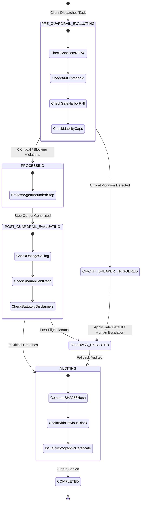

> Historical design proposal. For implemented behavior and scope, see README.md and REVIEW.md.

# GuardrailAI: Deterministic Workflow Layer Specification

## 1. Executive Summary & Problem Statement

High-consequence industries (Finance, Healthcare, Legal) cannot deploy autonomous LLM agents in critical operational paths due to:
1. **Probabilistic Non-Determinism**: Generalist models can hallucinate unauthorized steps, breach regulatory transaction ceilings, or disclose protected information (PHI/PII).
2. **Lack of Cryptographic Non-Repudiation**: Traditional application logging fails evidentiary standards under SOC-2, SEC Rule 17a-4, and HIPAA audit scrutiny.
3. **Absence of Hard Circuit Breakers**: When an agent goes out of bounds, standard pipelines either crash or pass hazardous outputs to production.

**GuardrailAI** provides a **zero-trust, deterministic multi-agent state machine** where compliance is structural.

---

## 2. Deterministic State Transition Flow

---

## 3. Mathematical & Algorithmic Guardrail Formulations

### 3.1 Cryptographic Audit Hash-Chaining
For any workflow execution $W$, each execution block $B_i$ is computed deterministically:
$$H_0 = \text{SHA-256}(\text{"GENESIS"} \parallel \text{workflow\_id} \parallel t_0)$$
$$H_i = \text{SHA-256}(H_{i-1} \parallel \text{step\_name} \parallel \text{agent\_name} \parallel \text{SHA-256}(\text{input}) \parallel \text{SHA-256}(\text{output}))$$

The tamper-verification function $\mathcal{V}(B)$ asserts:
$$\mathcal{V}(B) = \prod_{i=1}^{N} \mathbb{I}\left( B_i.\text{prev\_hash} = B_{i-1}.\text{curr\_hash} \land B_i.\text{curr\_hash} = \text{SHA-256}(...) \right) \in \{0, 1\}$$

### 3.2 Financial & Healthcare Guardrail Ceilings
- **OFAC Sanctions Filter**:
  $$\text{Country}(tx) \cap \mathcal{S}_{OFAC} = \emptyset$$
- **AML CTR Mandatory Threshold**:
  $$\text{Amount}(tx) < \$10,000.00 \quad (\text{Else trigger FinCEN CTR verification})$$
- **Clinical Medication Safety Ceiling (e.g. Warfarin)**:
  $$\text{Dosage}_{mg} \le 10.0\,\text{mg/day}$$

---

## 4. Multi-Agent Topology & Responsibilities

| Agent Name | Core Responsibility | Failure Mode Handling |
| :--- | :--- | :--- |
| **`ProcessAgent`** | Executes domain workflows within strictly defined parameters. | Bounded execution only; cannot bypass compliance checks. |
| **`ComplianceAgent`** | Intercepts pre/post requests against institutional & statutory rule trees. | Trips circuit breakers on `BLOCKING` or `CRITICAL` infractions. |
| **`AuditAgent`** | Maintains the immutable SHA-256 hash-chained ledger and issues signed certs. | Fails closed if tamper or hash mismatch is detected. |

---

## 5. Fallback Policies & Circuit Breaker Matrix

| Fallback Policy | Trigger Condition | Deterministic Remediation Action |
| :--- | :--- | :--- |
| **`SAFE_DEFAULT`** | Exceeded threshold or minor safety breach. | Clamps transaction to safe statutory limits and notifies admin. |
| **`HUMAN_ESCALATION`** | High-risk clinical or multi-million dollar transaction. | Halts execution, generates audit ticket, and awaits signed human approval. |
| **`REDACTION`** | PHI / PII present in clinical notes or legal text. | Automatically scrubs 18 Safe Harbor HIPAA identifiers. |
| **`REJECT_WITH_REASON`** | OFAC Sanctioned entity or uncapped liability trap. | Immediately blocks execution with non-negotiable compliance citation. |
